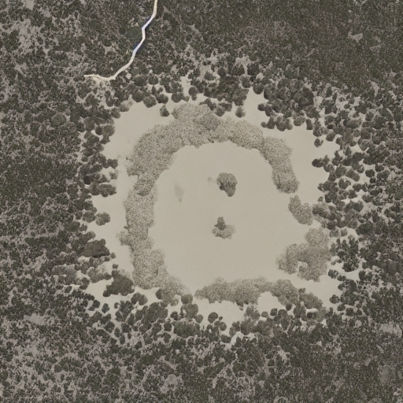

# Stable Diffusion + LoRA: ilustraciones de libros antiguos

Fine-tuning de **Stable Diffusion v1.4** (`CompVis/stable-diffusion-v1-4`) con **LoRA** sobre el dataset
[`gigant/oldbookillustrations`](https://huggingface.co/datasets/gigant/oldbookillustrations), para generar
imágenes con el estilo de los grabados e ilustraciones de libros antiguos.

<p align="center">
  
  <br><em>Prompt: "an image of a desert island"</em>
</p>

## Modelos en Hugging Face

| Modelo | Descripción | Enlace |
|---|---|---|
| Modelo completo | SD v1.4 con la LoRA fusionada en la UNet | [alvaroborre/sd-oldbookillustrations](https://huggingface.co/alvaroborre/sd-oldbookillustrations) |
| LoRA | Solo los pesos de la LoRA (se aplican sobre SD v1.4) | [alvaroborre/sd-lora-oldbookillustrations](https://huggingface.co/alvaroborre/sd-lora-oldbookillustrations) |

## Contenido del repositorio

- `Entrega.ipynb`: notebook completo (carga de datos, entrenamiento LoRA, generación y subida a Hugging Face).
- `requirements.txt`: librerías necesarias.
- `images/`: ejemplos generados con el modelo.

## Proceso

1. **Datos**: 600 imágenes de `gigant/oldbookillustrations`, usando la columna `1600px` como imagen y `info_alt` como texto descriptivo.
2. **Preprocesado**: redimensionado del lado corto a 512 px, recorte central 512x512 y normalización a [-1, 1].
3. **Modelo**: se cargan por separado tokenizer, text encoder (CLIP), VAE, UNet y scheduler DDPM. VAE y text encoder quedan congelados.
4. **LoRA**: se inyecta en las capas de atención de la UNet (`to_q`, `to_k`, `to_v`, `to_out.0`). Solo se entrenan las matrices de bajo rango, una fracción muy pequeña de los parámetros de la UNet.
5. **Entrenamiento**: las imágenes se codifican al espacio latente con el VAE, se añade ruido en un timestep aleatorio y la UNet aprende a predecirlo (pérdida MSE).
6. **Exportación**: se guardan los pesos de la LoRA y, por otro lado, se fusionan con el modelo base para publicar un modelo completo.

### Hiperparámetros

| Parámetro | Valor |
|---|---|
| Modelo base | `CompVis/stable-diffusion-v1-4` |
| Imágenes de entrenamiento | 600 |
| Resolución | 512x512 |
| Épocas | 6 |
| Batch size | 3 |
| Learning rate | 1e-4 (AdamW) |
| Rango LoRA / alpha | 6 / 6 |
| GPU | NVIDIA T4 (Google Colab) |

## Uso

```bash
pip install -r requirements.txt
```

**Modelo completo:**

```python
from diffusers import StableDiffusionPipeline
import torch

pipe = StableDiffusionPipeline.from_pretrained(
    "alvaroborre/sd-oldbookillustrations", dtype=torch.float16
).to("cuda")
pipe("an image of a desert island").images[0]
```

**Modelo base + LoRA:**

```python
pipe = StableDiffusionPipeline.from_pretrained(
    "CompVis/stable-diffusion-v1-4", dtype=torch.float16
).to("cuda")
pipe.load_lora_weights("alvaroborre/sd-lora-oldbookillustrations")
pipe("an image of a desert island").images[0]
```

Se necesita GPU con CUDA. En Google Colab: *Entorno de ejecución → Cambiar tipo de entorno de ejecución → GPU T4*.

## Licencia

Los pesos derivan de Stable Diffusion v1.4 y se distribuyen bajo la licencia
[CreativeML OpenRAIL-M](https://huggingface.co/spaces/CompVis/stable-diffusion-license).
